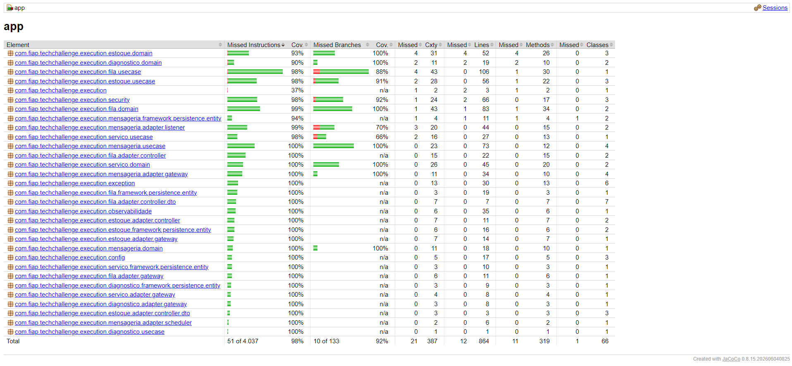
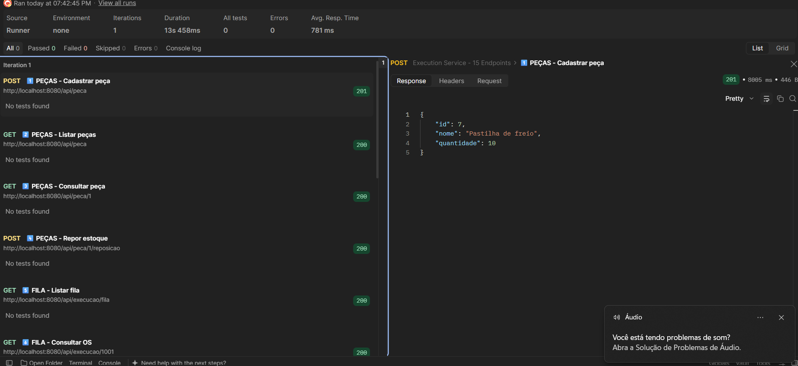
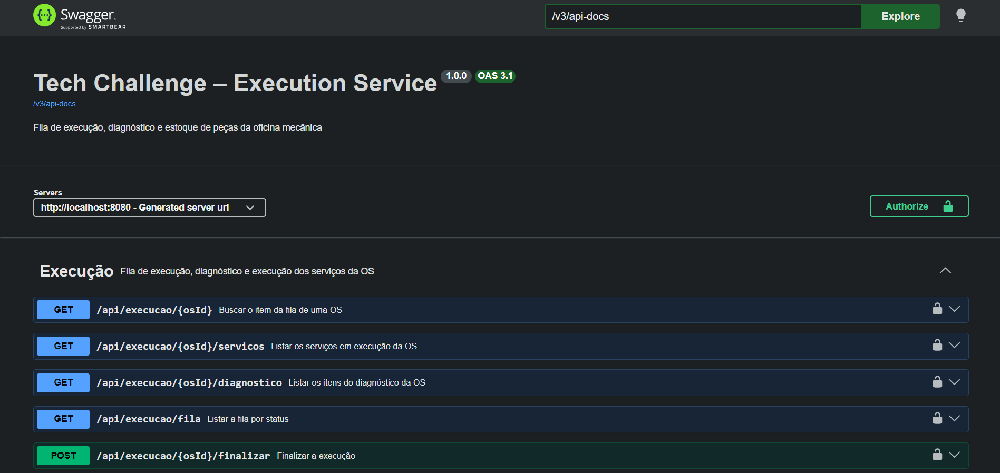

# tech-challenge-execution-service

Serviço de **execução** do **Tech Challenge — Fase 4**.

Um dos três microsserviços (`os-service`, `billing-service` e `execution-service`) em que o monolito da oficina mecânica foi dividido. Cuida da fila de execução das ordens de serviço, do diagnóstico, da reserva de peças em estoque e dos serviços executados. Escrito em **Spring Boot (Java 21)**, executado como workload no **Amazon EKS**, com autenticação stateless via JWT, banco **PostgreSQL** próprio (Amazon RDS) e comunicação assíncrona por **Amazon SQS** (entrada) e **Amazon SNS** (saída).

## Sumário

- [Repositórios relacionados](#repositórios-relacionados)
- [Tecnologias](#tecnologias)
- [Estrutura do Repositório](#estrutura-do-repositório)
- [Arquitetura](#arquitetura)
- [Pré-requisitos](#pré-requisitos)
- [Execução Local](#execução-local)
- [Testes e Cobertura](#testes-e-cobertura)
- [Observabilidade e Logging](#observabilidade-e-logging)
- [Build da Imagem Docker](#build-da-imagem-docker)
- [Variáveis de Ambiente](#variáveis-de-ambiente)
- [CI/CD e Deploy](#cicd-e-deploy)
- [Documentação da API](#documentação-da-api)
- [Exemplos de Uso da API](#exemplos-de-uso-da-api)
- [Análise de Código e Segurança](#análise-de-código-e-segurança)

---

## Repositórios relacionados

| Componente | Papel | Repositório |
| --- | --- | --- |
| `os-service` | Ordens de serviço; publica `OS_CRIADA` e `OS_CANCELADA` | https://github.com/rafaelllsilva/tech-challenge-os-service |
| `billing-service` | Orçamento e pagamento; publica `PAGAMENTO_*` | https://github.com/luisssato/tech-challenge-billing-service |
| Lambda de autenticação | Emite o JWT validado por este serviço |https://github.com/luisssato/tech-challenge-serverless|
| Infraestrutura (EKS, RDS, filas, tópico) | Provisiona os recursos usados no deploy |https://github.com/rafaelllsilva/fiap-fase3-infraestrutura |

---

## Tecnologias

- Java 21 (Amazon Corretto) e Gradle
- Spring Boot 4.0.5 (Spring MVC, Spring Data JPA, Spring Security, Spring Actuator)
- PostgreSQL 16 / Flyway (1 migration, schema `execution`)
- Amazon SQS (entrada) e Amazon SNS (saída) — Spring Cloud AWS 4.0.2 (LocalStack em desenvolvimento)
- JWT — JWT (`io.jsonwebtoken:jjwt`), assinatura HMAC-SHA256
- SpringDoc OpenAPI 3 (Swagger UI)
- Testcontainers (PostgreSQL e LocalStack), Cucumber (BDD), JaCoCo e SonarQube
- Docker — multi-stage build (`linux/amd64`)
- Kubernetes / Amazon EKS
- GitHub Actions (CI/CD)

---

## Estrutura do Repositório

```
tech-challenge-execution-service/

.github/workflows/
├── pr.yml          CI: testes, cobertura JaCoCo e build check da imagem Docker
└── deploy.yml      CD: testes, build/push no ECR e deploy no EKS via kubectl

app/
├── src/main/java/com/fiap/techchallenge/execution/
│   ├── fila/              fila de execução (ItemFila) e casos de uso da saga
│   │   ├── adapter/
│   │   │   ├── controller/     ExecucaoController (REST endpoints)
│   │   │   └── gateway/        FilaGatewayImpl (JPA persistence)
│   │   ├── domain/
│   │   │   ├── ItemFila.java                    Entidade: ordem de execução
│   │   │   └── StatusFila.java                  Enum: AGUARDANDO_*, NA_FILA, etc
│   │   ├── usecase/
│   │   │   ├── FilaUseCase.java                 Interface dos casos de uso
│   │   │   ├── FilaInteractor.java              Implementação (orquestração)
│   │   │   └── FilaGateway.java                 Interface de persistência
│   │   └── framework/
│   │       └── persistence/                     ItemFilaJpaRepository (Spring Data)
│   │
│   ├── diagnostico/       itens do diagnóstico (peças e serviços)
│   │   ├── adapter/
│   │   │   ├── controller/
│   │   │   └── gateway/
│   │   ├── domain/
│   │   │   ├── DiagnosticoItem.java
│   │   │   └── TipoDiagnostico.java             Enum: PECA, SERVICO
│   │   ├── usecase/
│   │   │   ├── DiagnosticoUseCase.java
│   │   │   ├── DiagnosticoInteractor.java
│   │   │   └── DiagnosticoGateway.java
│   │   └── framework/
│   │       └── persistence/
│   │
│   ├── estoque/           estoque de peças e reservas
│   │   ├── adapter/
│   │   │   ├── controller/     PecaController (GET/POST)
│   │   │   └── gateway/
│   │   ├── domain/
│   │   │   ├── Peca.java                        Entidade: peça em estoque
│   │   │   ├── ReservaPeca.java                 Entidade: reserva de peça
│   │   │   └── StatusReserva.java               Enum: ATIVA, LIBERADA, CANCELADA
│   │   ├── usecase/
│   │   │   ├── EstoqueUseCase.java
│   │   │   ├── EstoqueInteractor.java
│   │   │   └── EstoqueGateway.java
│   │   └── framework/
│   │       └── persistence/
│   │
│   ├── servico/           serviços executados na OS
│   │   ├── adapter/
│   │   │   ├── controller/
│   │   │   └── gateway/
│   │   ├── domain/
│   │   │   ├── Servico.java                     Entidade: serviço da OS
│   │   │   └── StatusServico.java               Enum: PENDENTE, EXECUTADO, CANCELADO
│   │   ├── usecase/
│   │   │   ├── ServicoUseCase.java
│   │   │   ├── ServicoInteractor.java
│   │   │   └── ServicoGateway.java
│   │   └── framework/
│   │       └── persistence/
│   │
│   ├── mensageria/        listeners SQS, outbox, publisher e idempotência
│   │   ├── adapter/
│   │   │   └── listener/        EventoEntradaListener (SQS consumer)
│   │   ├── domain/
│   │   │   ├── Evento.java                      Envelope de evento
│   │   │   ├── TipoEvento.java                  Enum: OS_CRIADA, PAGAMENTO_*, etc
│   │   │   ├── ProcessedEvent.java              Idempotência (eventId)
│   │   │   └── OutboxEvent.java                 Outbox para SNS
│   │   ├── usecase/
│   │   │   ├── EventoEntradaUseCase.java
│   │   │   ├── EventoEntradaInteractor.java     Switch nos 5 tipos
│   │   │   └── EventoEntradaGateway.java
│   │   └── framework/
│   │       ├── persistence/                     Repositórios JPA
│   │       └── publisher/                       SNS Publisher (scheduler outbox)
│   │
│   ├── security/          filtro JWT e configuração Spring Security
│   │   ├── JwtAuthenticationFilter.java         Filtro JWT
│   │   ├── JwtUtil.java                         Utilitário JWT (HMAC-SHA256)
│   │   └── SecurityConfig.java                  Configuração Spring Security
│   │
│   ├── config/            configurações gerais
│   ├── exception/         GlobalExceptionHandler
│   ├── observabilidade/   logging estruturado, métricas
│   └── ExecutionServiceApplication.java
│
├── src/main/resources/
│   ├── application.properties       configuração e variáveis de ambiente
│   ├── application-prod.properties  perfil de produção (SQS/SNS reais, sem LocalStack)
│   ├── logback-spring.xml           logs JSON em produção, colorido em dev
│   └── db/migration/                migration Flyway (V1)
│
├── src/test/
│   ├── java/.../bdd/                steps e configuração do Cucumber (BDD)
│   ├── resources/features/          cenários Gherkin (execucao.feature)
│   └── ...                          testes unitários, de integração e ponta a ponta
│
├── build.gradle                     dependências, JaCoCo (mínimo 80%) e SonarQube
└── Dockerfile                       multi-stage build para linux/amd64

k8s/
├── serviceaccount.yaml           ServiceAccount do pod (acesso à AWS)
├── configmap.yaml                variáveis não-sensíveis de configuração
├── deployment.yaml               Deployment (2 réplicas, RollingUpdate, probes, non-root)
├── service.yaml                  Service LoadBalancer — AWS NLB, porta 80 → 8080
├── hpa.yaml                      HPA: 2 a 10 réplicas (CPU 70%, memória 80%)
└── pod-disruption-budget.yaml    PDB: minAvailable 1

localstack/init-sqs.sh            cria no LocalStack as filas de entrada (com DLQ) e o tópico SNS

docker-compose.yml                stack local: App + PostgreSQL 16 + LocalStack (SQS/SNS) + SonarQube

docs/
├── EVENTOS.md                    contrato dos eventos trocados entre os serviços
└── img.png                       evidência de cobertura (JaCoCo)

README.md                          documentação completa do projeto
settings.gradle                    configuração Gradle
gradlew                           Gradle wrapper (Linux/Mac)
gradlew.bat                       Gradle wrapper (Windows)
```

Cada módulo de negócio segue a Clean Architecture do monolito: `domain` (regras puras) → `usecase` (interactors e gateways) → `adapter` (controllers e gateways) → `framework` (JPA).

---

## Arquitetura

```
                         ┌──────────────────────┐
                         │    Usuário/Mecânico  │
                         └──────────┬───────────┘
                                    │ REST
                                    ▼
                         ┌──────────────────────┐
                         │  Amazon API Gateway  │
                         │ /execution/{proxy+}  │
                         └──────────┬───────────┘
                                    │
                                    ▼
                         ┌──────────────────────┐
                         │ Network Load Balancer│
                         │        (NLB)         │
                         └──────────┬───────────┘
                                    │
                                    ▼
┌──────────────────────┐            │
│ SQS: os_execution    │            │
│ + DLQ                │            │
└──────────┬───────────┘            │
           │                        │
           │                        ▼
           │          ┌─────────────────────────────────────┐
           │          │ Amazon EKS (ns: execution-service)  │
           │          │                                     │
           ├─────────►│  ┌───────────────────────────────┐  │
                      │  │       Pods Spring Boot        │  │
┌──────────────────────┐│  │                               │  │
│ SQS: billing_execution│──►│  - REST Controllers         │  │
│ + DLQ                │  │  - Listeners SQS              │  │
└──────────────────────┘  │  - Validação JWT              │  │
                      │  │  - Regras da fila e estoque   │  │
                      │  │  - Idempotência               │  │
                      │  │  - Outbox + publisher         │  │
                      │  │  - Migrations Flyway          │  │
                      │  └──────────────┬────────────────┘  │
                      │                 │                   │
                      │        ┌────────┴────────┐          │
                      │        ▼                 ▼          │
                      │  ┌──────────────┐ ┌──────────────┐ │
                      │  │ Amazon RDS   │ │ Amazon SNS   │ │
                      │  │ PostgreSQL 16│ │ execution-   │ │
                      │  │ schema:      │ │ events       │ │
                      │  │ execution    │ │ (fan-out)    │ │
                      │  └──────────────┘ └──────────────┘ │
                      │                                     │
                      └─────────────────────────────────────┘
```

O cluster EKS se chama `tech-challenge`; o serviço roda no namespace `execution-service`.

### Saga (coreografada)

Não há orquestrador: cada serviço reage aos eventos dos outros. O `osId` é o `correlationId` de todo o fluxo.

1. `OS_CRIADA` → o item entra com status `AGUARDANDO_DIAGNOSTICO` (reentrega da mesma OS não duplica o item).
2. O mecânico inicia e conclui o diagnóstico via REST → `DIAGNOSTICO_CONCLUIDO` e status `AGUARDANDO_PAGAMENTO`. O billing monta o orçamento a partir do payload do evento.
3. `PAGAMENTO_CONFIRMADO` → as peças do diagnóstico são reservadas, os serviços da OS são criados, o evento `ESTOQUE_RESERVADO` é publicado e o item vai para `NA_FILA`.
4. O mecânico inicia a próxima execução (FIFO) → `EXECUCAO_INICIADA`, e finaliza → `EXECUCAO_FINALIZADA`.

**Falhas e compensações**

| Situação | Efeito |
| --- | --- |
| Estoque insuficiente ao confirmar o pagamento | Nada é reservado; item `FALHOU`; publica `EXECUCAO_FALHOU` (`SEM_ESTOQUE`) |
| Mecânico registra falha (`POST /api/execucao/{osId}/falha`) | Publica `EXECUCAO_FALHOU` (motivo informado, ou `FALHA_NA_EXECUCAO` se vazio); o billing estorna e o os-service cancela a OS |
| `PAGAMENTO_FALHOU` | O item é marcado como `FALHOU` (motivo `PAGAMENTO_FALHOU`) |
| `OS_CANCELADA` ou `PAGAMENTO_ESTORNADO` | Reservas liberadas, serviços pendentes cancelados e item `CANCELADA`; nenhum evento é publicado |

Casos de borda (detalhes em [`docs/EVENTOS.md`](docs/EVENTOS.md)):

- Cancelar um item já `CANCELADA` ou `FALHOU` não faz nada (por isso o `PAGAMENTO_ESTORNADO` que vem depois de um `EXECUCAO_FALHOU` é inofensivo).
- Cancelamento recebido antes do `OS_CRIADA` é descartado.
- Cancelar uma OS `FINALIZADA` é recusado e a mensagem acaba na DLQ.
- `PAGAMENTO_CONFIRMADO` antes do `OS_CRIADA` ou antes de o diagnóstico ser concluído falha e é reentregue pelo SQS; após 5 tentativas vai para a DLQ.

### Mensageria

**Entrada** — 2 filas SQS padrão (sem ordem garantida), cada uma com DLQ (`maxReceiveCount=5`). As mensagens são diferenciadas pelo campo `type` do envelope:

| Fila | Eventos | Origem |
| --- | --- | --- |
| `os_execution` | `OS_CRIADA`, `OS_CANCELADA` | os-service |
| `billing_execution` | `PAGAMENTO_CONFIRMADO`, `PAGAMENTO_FALHOU`, `PAGAMENTO_ESTORNADO` | billing-service |

- Para ser aceita, a mensagem precisa ter `eventId` (UUID válido) e `payload.osId`. Mensagem inválida lança erro, é reentregue e vai para a DLQ após 5 tentativas.
- O `eventId` é gravado em `processed_event` na mesma transação, então reentregas são ignoradas (SQS é *at-least-once*).
- O listener (`EventoEntradaListener`) faz o parsing do envelope e delega para o UseCase (`EventoEntradaInteractor`), que roteia por `processarDoOsExecution()` e `processarDoBillingExecution()`. Cada método contém um `switch` sobre o `type`.
- Se uma fila de entrada for assinante de um tópico SNS, a assinatura deve usar `RawMessageDelivery=true`: o serviço não desembrulha o campo `Message` do SNS.

**Saída** — os eventos são gravados na tabela `outbox_event` na mesma transação da mudança de estado e publicados no tópico SNS `execution-events` por um scheduler (`FOR UPDATE SKIP LOCKED`, seguro com várias réplicas). Assim, um evento só existe se a mudança também existiu. O `type` também vai como atributo da mensagem, para filter policies.

| Evento | Destino |
| --- | --- |
| `DIAGNOSTICO_CONCLUIDO` | billing-service |
| `ESTOQUE_RESERVADO` | os-service (informativo) |
| `EXECUCAO_INICIADA` | os-service |
| `EXECUCAO_FINALIZADA` | os-service |
| `EXECUCAO_FALHOU` | os-service e billing-service |

O contrato completo (envelope e payloads) está em [`docs/EVENTOS.md`](docs/EVENTOS.md).

### Dados entre serviços

O serviço tem banco próprio e não lê o banco de nenhum outro. Só guarda os ids e as cópias mínimas que chegam nos eventos (solicitação e placa/modelo do veículo). No diagnóstico, o `refId` de uma peça é o id em `peca_estoque` e o `refId` de um serviço é o `tipoServicoId` do catálogo do billing (o preço é do billing).

---

## Pré-requisitos

- **Docker** — suficiente para subir tudo com `docker compose`.
- **Java JDK 21** — necessário para rodar com Gradle (`bootRun`) e para executar os testes (`./gradlew`). Os testes também precisam do Docker rodando (Testcontainers).
- **kubectl e AWS CLI v2** — apenas para inspecionar o cluster manualmente.

---

## Execução Local

### Docker Compose

Sobe o PostgreSQL 16, o LocalStack (SQS e SNS com as filas e o tópico criados por `localstack/init-sqs.sh`; a fila `execution-events-local` assina o tópico para inspeção) e a aplicação compilada via `Dockerfile`:

```
docker compose up --build -d
```

A API fica disponível em `http://localhost:8080` (PostgreSQL em `localhost:5434`, SQS e SNS em `localhost:4566`).

Para incluir o SonarQube na stack (porta 9000):

```
docker compose --profile tools up -d
```

O compose é **somente para desenvolvimento local**. Em produção não há compose: a imagem roda no EKS pelos manifestos de `k8s/`, com o perfil `prod`, que usa o SQS, o SNS e o RDS reais.

### Gradle

Sobe apenas o banco e o LocalStack (SQS/SNS) e executa a aplicação com hot-reload:

```
docker compose up -d db localstack
./gradlew bootRun
```

---

## Testes e Cobertura

Os testes de integração usam Testcontainers (PostgreSQL e LocalStack), então o Docker precisa estar rodando.

```
./gradlew :app:test :app:jacocoTestReport :app:jacocoTestCoverageVerification
```

Relatório HTML gerado em `app/build/reports/jacoco/test/html/index.html`. A build falha se a cobertura ficar abaixo de 80%.

### Evidência de cobertura

Medição do JaCoCo (`jacocoTestReport`) com a suíte completa: **116 testes (incluindo 3 cenários BDD), 0 falhas**. Os números são uma fotografia da última medição; o CI gera o relatório a cada execução.

| Métrica    | Cobertura |
| ---------- | --------- |
| Instruções | 98,73%    |
| Linhas     | 98,61%    |
| Branches   | 92,49%    |
| Métodos    | 96,55%    |
| Classes    | 98,48%    |

A suíte tem testes unitários (domínio e casos de uso), de integração com Testcontainers (gateways, outbox e idempotência no PostgreSQL), de controllers (`@WebMvcTest` com JWT real) e um teste ponta a ponta com PostgreSQL e LocalStack (SQS e SNS). O relatório do JaCoCo também é publicado como artefato em cada execução do CI (`jacoco-report` no `pr.yml` e `test-and-coverage-reports` no `deploy.yml`).

[](docs/img.png)

### BDD (Cucumber)

Os cenários ficam em `app/src/test/resources/features/execucao.feature` (Gherkin em português) e sobem a aplicação completa com PostgreSQL e LocalStack via Testcontainers, usando JWT real, REST, filas SQS e tópico SNS:

1. OS paga entra na fila, é executada e finaliza (publica `EXECUCAO_FINALIZADA`).
2. Falta de estoque falha a execução sem reservar nada (publica `EXECUCAO_FALHOU` com `SEM_ESTOQUE`).
3. Cancelamento da OS compensa a reserva de peças (estoque devolvido, status `CANCELADA`).

```
./gradlew :app:test --tests "*CucumberSuiteTest"
```

Relatório HTML em `app/build/reports/cucumber/cucumber.html`.

---

## Observabilidade e Logging

Todos os logs da aplicação seguem um **padrão estruturado em JSON** com campos-chave para rastreamento e auditoria:

| Campo                   | Descrição                                                           | Exemplo                                                           |
| ----------------------- | ------------------------------------------------------------------- | ----------------------------------------------------------------- |
| `service`               | Nome do serviço                                                     | `"execution-service"`                                             |
| `correlationId`         | Id de rastreamento: sempre o `osId` (como string) em todo o fluxo   | `"10"`                                                            |
| `orderId`               | ID da Ordem de Serviço                                              | `10`                                                              |
| `eventId` / `eventType` | Evento envolvido no processamento                                   | `"OS_CRIADA"`                                                     |
| `operation`             | Ação executada                                                      | `"receber_evento"`, `"processar_evento"`, `"confirmar_pagamento"` |
| `outcome`               | Resultado                                                           | `"sucesso"`, `"falha"`, `"recebida"`, `"confirmado"`              |
| `message`               | Descrição em português                                              | `"Mensagem recebida na fila os_execution"`                        |

**Exemplo de log em produção:**

```
{
  "@timestamp": "2026-11-13T16:17:01.523Z",
  "service": "execution-service",
  "correlationId": "10",
  "orderId": 10,
  "eventId": "501ddf7b-228e-497c-8b4f-84124f0d35dd",
  "eventType": "ESTOQUE_RESERVADO",
  "operation": "processar_evento",
  "outcome": "confirmado",
  "message": "Reserva de estoque registrada no histórico da OS"
}
```

Métricas no formato Prometheus em `/actuator/prometheus` e probes de saúde em `/actuator/health` (liveness e readiness).

---

## Build da Imagem Docker

```
docker build --platform linux/amd64 -t tech-challenge-execution-service:local -f app/Dockerfile .
```

O flag `--platform linux/amd64` é obrigatório. Os nós do cluster EKS utilizam `AL2023_x86_64_STANDARD`; uma imagem ARM64 causará `ImagePullBackOff` no deploy.

---

## Variáveis de Ambiente

### 1) Variáveis que o app recebe no runtime

Estas são as variáveis que a aplicação lê em execução (pod / local / docker):

| Variável                                                            | Padrão (dev local)                                    | Descrição                                                                                              |
| ------------------------------------------------------------------- | ----------------------------------------------------- | ------------------------------------------------------------------------------------------------------ |
| `DB_URL` (`SPRING_DATASOURCE_URL`)                                  | `jdbc:postgresql://localhost:5434/execution`          | URL JDBC de conexão com o banco; em produção é o host do RDS (com `sslmode=require`), não o ARN do Secrets Manager |
| `DB_USER` (`SPRING_DATASOURCE_USERNAME`)                            | `postgres`                                            | Usuário do banco                                                                                       |
| `DB_PASSWORD` (`SPRING_DATASOURCE_PASSWORD`)                        | `admin`                                               | Senha do banco (padrão apenas para dev local)                                                          |
| `JWT_SECRET`                                                        | `minha-chave-secreta-dev-minimo-32-chars!!`           | Chave de assinatura dos tokens JWT, a mesma usada pelo Lambda de autenticação (padrão apenas para dev local) |
| `SPRING_PROFILES_ACTIVE`                                            | —                                                     | `prod` em produção: remove o endpoint do LocalStack e as credenciais fixas                             |
| `SQS_ENDPOINT`                                                      | `http://localhost:4566`                               | Endpoint do SQS (somente local)                                                                        |
| `AWS_REGION`                                                        | `us-east-1`                                           | Região da AWS                                                                                          |
| `AWS_ACCESS_KEY_ID` / `AWS_SECRET_ACCESS_KEY`                       | `test` / `test`                                       | Credenciais AWS **somente local**. Em produção não há chaves no pod: ele usa o ServiceAccount `execution-service` e a role dos nós (AWS Academy) |
| `SQS_OS_EXECUTION`                                                  | `os_execution`                                        | Nome da fila SQS para eventos do OS (`OS_CRIADA`, `OS_CANCELADA`)                                      |
| `SQS_BILLING_EXECUTION`                                             | `billing_execution`                                   | Nome da fila SQS para eventos do Billing (`PAGAMENTO_CONFIRMADO`, `PAGAMENTO_FALHOU`, `PAGAMENTO_ESTORNADO`) |
| `SNS_ENDPOINT`                                                      | `http://localhost:4566`                               | Endpoint do SNS (somente local)                                                                        |
| `SNS_TOPICO_ARN`                                                    | `arn:aws:sns:us-east-1:000000000000:execution-events` | ARN do tópico SNS onde os eventos são publicados; não é a fila SQS, e sim o tópico da saída            |
| `SQS_MAX_CONCURRENT`                                                | `2`                                                   | Concorrência dos listeners (deve caber no pool de 3 conexões do banco)                                 |
| `OUTBOX_ENABLED` / `OUTBOX_INTERVALO_MS` / `OUTBOX_LOTE`            | `true` / `1000` / `50`                                | Publicação da outbox                                                                                   |
| `SWAGGER_BASE_PATH`                                                 | —                                                     | Prefixo de caminho do Swagger; definido no ConfigMap (`/Prod`)                                         |

A aplicação **não cria** filas nem tópicos: se uma fila de entrada não existir, ela falha na subida (`queue-not-found-strategy=FAIL`).

### 2) Variáveis que o GitHub / pipeline usa para montar o runtime

Essas não são usadas diretamente pelo app; elas servem para a pipeline buscar os dados reais da infraestrutura e gerar o Secret e o ConfigMap do Kubernetes:

| Nome                                                  | Tipo     | Descrição                                                                                         |
| ----------------------------------------------------- | -------- | ------------------------------------------------------------------------------------------------- |
| `AWS_ACCESS_KEY_ID` / `AWS_SECRET_ACCESS_KEY`         | Secret   | Credenciais AWS da pipeline                                                                       |
| `AWS_SESSION_TOKEN`                                   | Secret   | Token de sessão temporário (AWS Academy Learner Lab)                                              |
| `JWT_SECRET`                                          | Secret   | Chave de assinatura dos tokens JWT (mínimo 32 caracteres; igual à do Lambda)                      |
| `DB_SECRET_ID`                                        | Variável | Nome ou ARN do segredo do RDS no AWS Secrets Manager (só identifica o segredo; não é a URL do banco) |
| `SQS_OS_EXECUTION`                                    | Variável | Nome da fila SQS **já existente** para eventos do OS                                              |
| `SQS_BILLING_EXECUTION`                               | Variável | Nome da fila SQS **já existente** para eventos do Billing                                         |
| `SNS_TOPICO_ARN`                                      | Variável | ARN do tópico SNS **já existente** onde o serviço publica; não é o ARN de uma fila                |

> Importante: o `DB_SECRET_ID` aponta para o segredo do banco no AWS Secrets Manager. A pipeline busca esse segredo, extrai `host`, `port`, `dbname`, `username` e `password`, e gera `DB_URL`, `DB_USER` e `DB_PASSWORD` (e as variantes `SPRING_DATASOURCE_*`) no Secret `execution-secrets`, junto com o `JWT_SECRET`. Os nomes das filas e o ARN do tópico vão para o ConfigMap `app-config`.

---

## CI/CD e Deploy

| Workflow     | Disparo                          | O que faz                                                                                                                                                                       |
| ------------ | -------------------------------- | ------------------------------------------------------------------------------------------------------------------------------------------------------------------------------- |
| `pr.yml`     | Pull Request para `main`         | Executa testes, verifica cobertura JaCoCo e valida o build da imagem Docker                                                                                                     |
| `deploy.yml` | Push na `main` ou disparo manual | Roda testes e cobertura; publica a imagem no ECR; garante o namespace; aplica ServiceAccount, ConfigMap e o Secret do banco (via Secrets Manager); aplica os manifestos no EKS e aguarda o rollout |

### O que já precisa existir

A pipeline **não provisiona** estes recursos; eles vêm da infraestrutura:

- Repositório ECR `execution-service`
- Cluster EKS `tech-challenge`
- Banco RDS e o segredo correspondente no Secrets Manager (o RDS é provisionado em um repositório de infraestrutura separado; o banco do serviço é isolado, nenhum outro serviço o acessa, e o Flyway cria o schema `execution` e as tabelas na subida)
- Filas SQS `os_execution` e `billing_execution` (cada uma com DLQ) e o tópico SNS `execution-events`
- Assinaturas do tópico pelas filas do os-service e do billing-service, com filter policy por `type` e `RawMessageDelivery=true`

### Permissões

- Usuário AWS da pipeline: login e push no ECR, `eks:DescribeCluster` (para `update-kubeconfig`) e `secretsmanager:GetSecretValue`.
- Aplicação (pod): `sns:Publish` no tópico e acesso de leitura/remoção de mensagens às filas de entrada.

### Deploy manual

- **Pelo GitHub Actions:** rode o workflow `deploy.yml` manualmente (*Run workflow*). Nesse modo ele também reinicia o Deployment (`rollout restart`).
- **Inspeção do cluster:**

  ```
  aws eks update-kubeconfig --region us-east-1 --name tech-challenge
  kubectl get pods -n execution-service
  kubectl logs -f deployment/execution-service -n execution-service
  kubectl get hpa -n execution-service
  ```

O endpoint do LoadBalancer é exibido no final do job de deploy.

---

## Documentação da API

Com a aplicação em execução:

- Swagger UI: `http://<HOST>/swagger-ui/index.html` (também em `/swagger-ui.html`)
- OpenAPI JSON: `http://<HOST>/v3/api-docs`
- Health: `http://<HOST>/actuator/health`
- Métricas Prometheus: `http://<HOST>/actuator/prometheus`

### Endpoints

A autenticação usa o token JWT emitido pelo Lambda de autenticação (`Authorization: Bearer <token>`, com os claims `sub` e `role`). Sem token a API responde `403`.

| Método | Rota                                        | Perfis                       | Descrição                            |
| ------ | ------------------------------------------- | ---------------------------- | ------------------------------------ |
| GET    | `/api/execucao/fila`                        | MECANICO, ATENDENTE, GERENTE | Lista a fila (`?status=`)            |
| GET    | `/api/execucao/{osId}`                      | MECANICO, ATENDENTE, GERENTE | Consulta o item da OS                |
| GET    | `/api/execucao/{osId}/diagnostico`          | MECANICO, ATENDENTE, GERENTE | Itens do diagnóstico                 |
| GET    | `/api/execucao/{osId}/servicos`             | MECANICO, ATENDENTE, GERENTE | Serviços da OS                       |
| POST   | `/api/execucao/{osId}/diagnostico/iniciar`  | MECANICO, GERENTE            | Inicia o diagnóstico                 |
| POST   | `/api/execucao/{osId}/diagnostico/concluir` | MECANICO, GERENTE            | Conclui o diagnóstico                |
| POST   | `/api/execucao/iniciar`                     | MECANICO, GERENTE            | Inicia a próxima execução da fila    |
| POST   | `/api/execucao/{osId}/finalizar`            | MECANICO, GERENTE            | Finaliza a execução                  |
| POST   | `/api/execucao/{osId}/falha`                | MECANICO, GERENTE            | Registra falha na execução           |
| GET    | `/api/peca`, `/api/peca/{id}`               | GERENTE                      | Consulta peças em estoque            |
| POST   | `/api/peca`                                 | GERENTE                      | Cadastra peça em estoque             |
| POST   | `/api/peca/{id}/reposicao`                  | GERENTE                      | Repõe o estoque                      |

---

## Exemplos de Uso da API

### 1. Cadastro de peça em estoque

- **Requisição (`POST /api/peca`):**

  ```
  POST /api/peca
  Content-Type: application/json
  Authorization: Bearer <token>

  {
    "nome": "Pastilha de freio",
    "quantidade": 5
  }
  ```

- **Resposta (`201 Created`):**

  ```
  { "id": 1, "nome": "Pastilha de freio", "quantidade": 5 }
  ```

### 2. Conclusão do diagnóstico

Chega o evento `OS_CRIADA` e o mecânico inicia e conclui o diagnóstico. No `refId`, peça é o id da peça em estoque (`1`, do exemplo acima) e serviço é o `tipoServicoId` do catálogo do billing.

- **Requisição (`POST /api/execucao/10/diagnostico/concluir`):**

  ```
  POST /api/execucao/10/diagnostico/concluir
  Content-Type: application/json
  Authorization: Bearer <token>

  {
    "itens": [
      { "tipo": "PECA", "refId": 1, "quantidade": 2 },
      { "tipo": "SERVICO", "refId": 3, "quantidade": 1 }
    ]
  }
  ```

- **Resposta (`200 OK`):**

  ```
  {
    "osId": 10,
    "status": "AGUARDANDO_PAGAMENTO",
    "mecanicoId": 7,
    "solicitacao": "Barulho no freio",
    "veiculoPlaca": "ABC1D23",
    "veiculoModelo": "Gol"
  }
  ```

  O evento `DIAGNOSTICO_CONCLUIDO` é publicado no tópico `execution-events`.

### 3. Início e finalização da execução

Depois do evento `PAGAMENTO_CONFIRMADO` o item está em `NA_FILA` e o estoque foi reservado.

- **Iniciar a próxima da fila (`POST /api/execucao/iniciar`):**

  ```
  { "mecanicoId": 7 }
  ```

  Resposta `200 OK` com `"status": "EM_EXECUCAO"`.

- **Finalizar (`POST /api/execucao/10/finalizar`):**

  ```
  { "mecanicoId": 7 }
  ```

  Resposta `200 OK` com `"status": "FINALIZADA"` e o evento `EXECUCAO_FINALIZADA` publicado no tópico `execution-events`.

---

## Comprovação de funcionamento

[](docs/img_1.png)

[Arquivo de teste do Postman](docs/execution_service-teste_endpoints.postman_collection.json)

[Swagger para execução](http://localhost:8080/swagger-ui/index.html)

[](docs/img_2.png)


## Análise de Código e Segurança

### SonarQube

```
docker compose --profile tools up -d sonarqube
# Acesse http://localhost:9000, gere um token e execute:
./gradlew test jacocoTestReport sonar -Dsonar.token=<TOKEN>
```

### Segurança

- **Autenticação e autorização:** JWT stateless (HMAC-SHA256) com controle por perfil (`MECANICO`, `ATENDENTE`, `GERENTE`) em cada endpoint.
- **Segredos:** credenciais do banco vêm do AWS Secrets Manager e são gravadas no Secret `execution-secrets` pela pipeline (com a senha mascarada nos logs); o `JWT_SECRET` fica em GitHub Secrets. Nenhum segredo de produção é versionado. Os valores padrão de `application.properties` são apenas para desenvolvimento local.
- **Banco:** conexão com o RDS com `sslmode=require`.
- **Container:** o pod roda como não-root (`runAsNonRoot`), sem escalada de privilégio e sem capabilities (`drop: ALL`).
- **Acesso à AWS:** sem chaves no pod; o acesso vem do ServiceAccount e da role dos nós.